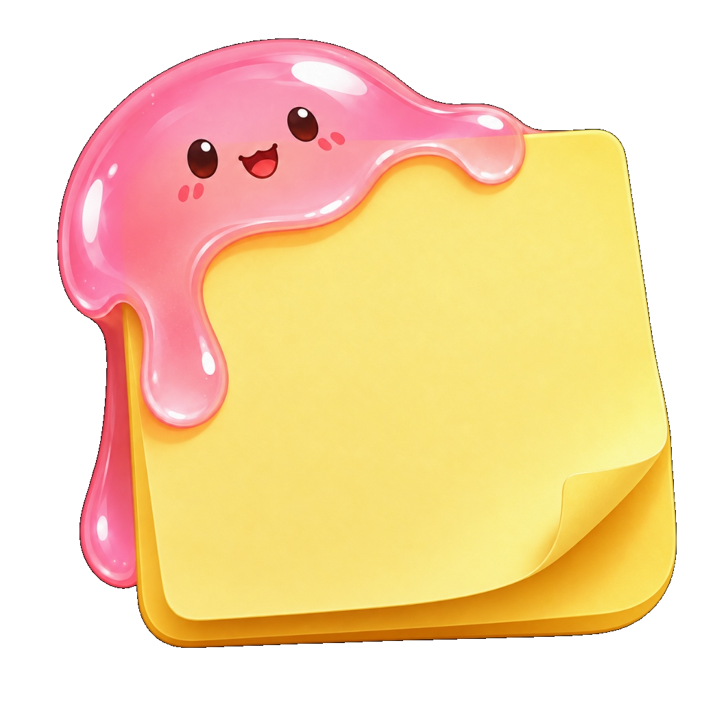

<div align="center">
  
  <h1>ScreenStick</h1>
  <p><strong>Sticky notes desktop application designed to stick directly onto your laptop screen.</strong></p>
</div>

ScreenStick is a clean, minimalist, and lightweight desktop application built with Python and Tkinter for Windows. It is designed to stick notes directly to your screen like a wallpaper—staying at the desktop level so other windows naturally come on top, while giving you instant access to notes when you need them.

---

## ✨ Key Features

- **Direct Screen Sticking (Wallpaper Feel)**:
  - By default, notes stay unpinned at the standard desktop layer. When you switch to another application (Chrome, VS Code, Word), that application smoothly renders on top of the note.
  - Pin toggle (`📌`) is available in the menu if you want a note to float permanently on top of all windows.

- **Zero Wasted Space & Hover-Only Controls**:
  - **When unhovered**: All surrounding buttons, toolbars, and borders vanish completely. Only your text on a soft pastel background exists.
  - **When hovered**: A sleek top header appears with `＋  tools  ⋯  ✕`.
  - **Clean bottom**: Zero bottom toolbars or footers—the text editor fills the note from edge to edge.

- **Top Header Layout (`＋  tools  ⋯  ✕`)**:
  - `＋` **New Note**: Spawns a new sticky note with smart cascading placement.
  - **Formatting Tools**:
    - **B**: Bold (`Ctrl+B`)
    - **I**: Italic (`Ctrl+I`)
    - **U**: Underline (`Ctrl+U`)
    - **S**: Strikethrough (`Ctrl+T`)
    - **•**: Bullet list
    - **☑**: Interactive checklist (`[ ] ` and `[✓] `)
  - **Draggable Area**: Click and drag anywhere between the tools to move the note around your screen.
  - `⋯` **Menu**:
    - **7 Pastel Themes**: Butter Yellow, Sage Mint, Sky Breeze, Blush Rose, Soft Lavender, Warm Peach, Velvet Charcoal.
    - **Pin Toggle**: Switch between Desktop Sticking and Always-on-Top.
    - **Font Size**: Quick `A-` and `A+` scaling.
    - **Notes Hub**: Central manager and search.
  - `✕` **Delete**: Closes and removes the note.

- **SQLite Persistence**:
  - Notes, text, formatting ranges, positions, dimensions, and pin states are safely saved in local SQLite database (`notes.db`).
  - No lag, no JSON corruptions, fully ACID-compliant.

- **Smart Auto-Start on Windows Boot**:
  - Automatically configured in Windows Startup (`shell:startup`).
  - **Respects empty state**: If you closed/deleted all notes, the app remains completely quiet and won't show anything on startup.
  - If you have active notes, they greet you on your desktop when turning on your laptop.

---

## 🚀 Quick Start

### Run directly:
```bash
python app.py
```
Or launch without a console window via `pythonw`:
```bash
pythonw app.py
```

### Desktop Shortcut:
Run `create_desktop_shortcut.py` to create a `ScreenStick.lnk` on your Windows Desktop:
```bash
python create_desktop_shortcut.py
```

---

## ⌨️ Keyboard Shortcuts

| Shortcut | Action |
| :--- | :--- |
| `Ctrl + N` | New Note |
| `Ctrl + B` | Toggle Bold |
| `Ctrl + I` | Toggle Italic |
| `Ctrl + U` | Toggle Underline |
| `Ctrl + T` | Toggle Strikethrough |
| `Right-Click` | Context Menu (Cut, Copy, Paste, Formatting) |

---

## 📁 Architecture

```
sticky-note/
├── app.py                     # Main application controller & window manager
├── note_window.py             # Frameless note window with hover "+ tools ... x"
├── storage.py                 # SQLite storage layer (notes.db)
├── styles.py                  # Pastel palettes, Segoe UI typography & Win32 DWM helpers
├── notes_hub.py               # Searchable central manager for all notes
├── autostart.py               # Windows Startup shortcut manager
├── create_desktop_shortcut.py # Desktop shortcut generator
├── run.bat                    # One-click Windows batch launcher
└── test_app.py                # Automated test suite
```

---

## 📄 License
MIT License.
